# The Yuzu Board


A route tracker for a home bouldering board. It draws the wall to scale and lets you set boulders by tagging holds. It also keeps a shared logbook of sends, repeats, and first ascents.


## Run it

The live app runs on a Raspberry Pi at <http://yuzuberrypi.local>, which keeps the one database, takes each new version from GitHub by itself, and is copied to the Mac every 15 minutes. Away from home, your own devices reach it through [Tailscale](docs/deploy.md#away-from-home). [docs/deploy.md](docs/deploy.md) covers it: setting it up, the test app for trying changes, and what to do when the Pi is down. What follows is running it on any computer, as the Pi and the test app do.

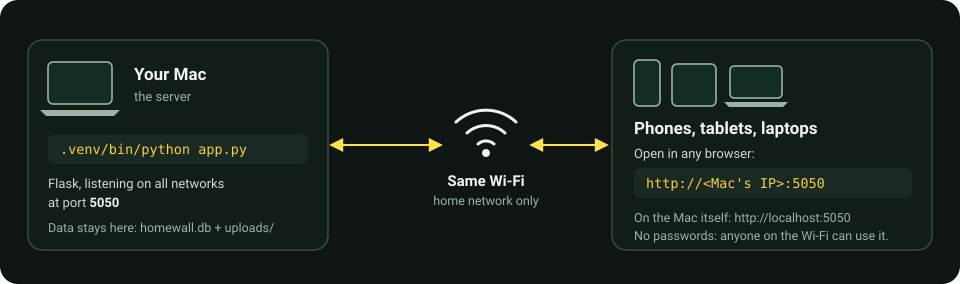

It needs Python 3.9 or newer (the one that comes with macOS will do).

```sh
python3 -m venv .venv
.venv/bin/pip install -r requirements.txt
.venv/bin/python app.py
```

Then open <http://localhost:5050>. The server listens on all interfaces, so phones on the same Wi‑Fi can use `http://<your-mac's-IP>:5050`. On the first run the database (`homewall.db`) is created and filled with demo data. Demo data only ever goes into a database nobody has used yet: clearing every climb and hold off the wall doesn't bring it back.

- Reset to fresh demo data: `.venv/bin/python seed.py --reset`. This deletes the database, so it also clears the admin login, and deletes the uploaded hold images.
- Run the tests: `.venv/bin/python -m unittest discover tests`
- Working on the code: [docs/development.md](docs/development.md) maps the modules, the API and how to add a page.

### Options

| | |
|---|---|
| `--port 5050` | The port to serve on |
| `--host 0.0.0.0` | The address to listen on. The default, `0.0.0.0`, is every network, so phones can connect; `127.0.0.1` is this Mac only |
| `--db homewall.db` | The database file |
| `--uploads uploads/holds` | The folder for hold images |
| `--debug` | Restarts the server when a `.py` file changes and shows errors in full. Only this Mac can connect, since the debugger it adds runs any code it's sent; `--host` overrides that, with a warning |
| `--reload` | Restarts the server when a `.py` file changes, without the debugger, so phones can still connect (the test app uses it) |
| `--label TEXT` | Marks every page as not the live app, e.g. `--label "Test copy"` |
| `--set-admin NAME` | Makes NAME the admin and asks for their password, then exits (see below) |

### Keeping it running

On the Pi, systemd keeps it running, starts it at boot and restarts it after each deploy ([docs/deploy.md](docs/deploy.md)). On another computer, to keep the server going after the terminal closes:

```sh
nohup .venv/bin/python app.py > yuzu.log 2>&1 &
```

After updating the code, restart it: find it with `lsof -i :5050`, `kill` that PID, and start it again. Pages and styles are read fresh on every reload, but changes to the Python files or `schema.sql` only take effect on a restart. A tab that says "Request failed (404)" after an update usually means the old server is still running.

### Your data

Everything is in two places, both kept out of git: the database `homewall.db` and the hold images in `uploads/holds/`. On the Pi they're in `~/yuzu-data/`, which snapshots the database every 15 minutes and is copied to the Mac's `~/YuzuBoard/replica/` ([docs/deploy.md](docs/deploy.md)). Elsewhere, back up both. (`uploads/holds/board/` only holds smaller copies of the images, which are made again when missing.) To copy the database while the server is running, use SQLite's backup, which never catches it half-written:

```sh
sqlite3 homewall.db ".backup homewall-backup.db"
```

To move to another computer, copy `homewall.db` and `uploads/holds/` into a fresh copy of the code and set it up as above. A database from an older version is updated in place on the first start.

### The admin login

One climber can be the admin, with a password. Only the admin sees the [Outdoors](#outdoors) and [Workout](#workout) tabs (and their outdoor days in the [Logbook](#logbook)), and only they can log sends and tries as themselves. Everything else stays open to everyone. Until an admin is set, nobody needs a password.

```sh
.venv/bin/python app.py --set-admin Masa    # asks for the password twice, then exits
```

The name is added as a climber if it's new. Choosing the admin in the climber menu then asks for the password, once per device: the login lasts a year. **Log out** is at the bottom of the same menu. Running `--set-admin` again changes the password and logs out every device. The password is stored hashed; the key that signs the login cookie is made on the first run and kept in the database.

On your home Wi‑Fi the password travels unencrypted (plain `http://`). Away from home, the app is reached through Tailscale, which encrypts the connection ([docs/deploy.md](docs/deploy.md#away-from-home)).

## The wall

| | |
|---|---|
| T-nut grid | 40 columns × 39 rows, 3" apart |
| Columns | lettered **right → left**: `A` … `Z`, `AA` … `AN` |
| Rows | numbered **top → bottom**: `1` … `39` |
| First hole (`A1`) | 1.5" from the right edge, 2.75" from the top |
| Wall size | 120" × 118.75" (1.5" past the last column, 2" past the last row) |
| **Footboard** | 120" × 8", drawn 1" below the main panel |
| Footboard t-nuts | 15 columns × 2 rows: columns 8" apart starting 4" from the right, lettered **A′ … O′** right → left; rows **40** and **41**, 2.5" from the footboard's top and bottom |
| **Side panels** | 8" × 118.75", one either side of the main panel, drawn 1" from it: from the top of the wall to the bottom of the main panel (not beside the footboard). No t‑nuts; rows 1–39 are numbered just outside them |
| **Ceiling** | 120" × 18", across the top of the main panel, drawn 1" above it. No t‑nuts, but the columns' grid lines carry on across it, with the column letters above it |


The geometry lives in `geometry.py` and is served to the browser at `/api/board`. Holds store a free `x, y` position in inches, so they can sit anywhere on the main board, the footboard, a side panel or the ceiling, not just on a t‑nut. Each hold on the main board or footboard also records its **nearest** t‑nut, and its name is a noun starting with that column's letter. For AA…AN the name starts with the second letter, so a hold near AB9 might be "Biscuit". On the footboard, C′ gives a C noun. The side panels have no t‑nuts, so their holds are named by panel: **L** nouns on the left panel ("Lantern"), **R** nouns on the right ("Raven"). The ceiling has no t‑nuts either, but its holds take the letter of the column they're under, read off the grid lines: an F noun above column F. Hovering a hold shows its name.

## Using it

The numbered markers in a screenshot (①, ②, …) match the numbered points that follow it. The screenshots show demo climbs on the real wall.

### Grades

Each climb has one of five grades, shown as a sprout or as one to four yuzu. Each is roughly a band of the V scale:

| Grade | Shown as | V scale (rough) |
|---|---|---|
| Warm-up | a sprout | V0–V4 |
| Easy | ●○○○ | V5–V6 |
| Medium | ●●○○ | V7–V8 |
| Hard | ●●●○ | V9–V10 |
| Project | ●●●● | V11+ |

The V range appears after the Grade line on a climb's page and under each grade in [Set boulder](#set-boulder). Hover any grade, or a grade filter chip on the Climbs list, to see it there too.

### Climbing as and zoom

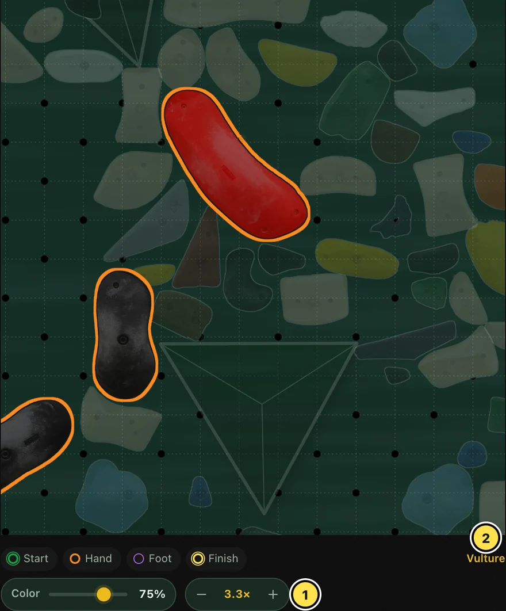

- **Climbing as:** pick yourself in the top-right corner. You can add new climbers from the same menu. Only the admin needs a password (see [The admin login](#the-admin-login)); their name reads "— log in…" until they do.
- **Zoom (every view of the board):** up to 6×, or 4× on phones and other touch screens (past about 2.5× on a phone, the holds off the climb look a little soft; those on it stay sharp). ① The **− 1× +** buttons on the board and the + / − keys zoom around the middle of the view; Ctrl + scroll or a pinch zooms where you point. Tap the level (or press 0) for the whole wall. Zoomed in, drag (or scroll) to pan; a tap still picks a hold. On a touch screen a tap picks the hold it's nearest, so it needn't land right on a small one. A quick drag keeps gliding and slows to a stop; touching the board stops it. While you pinch, the wall stretches and is drawn sharp again once your fingers lift. On phones, one finger scrolls the page as usual until you zoom in, and on a climb's page the swipe to the next climb works whenever the board isn't zoomed. Each new page starts from the whole wall.
- ② Hovering a hold shows its name under the board.

### Climbs

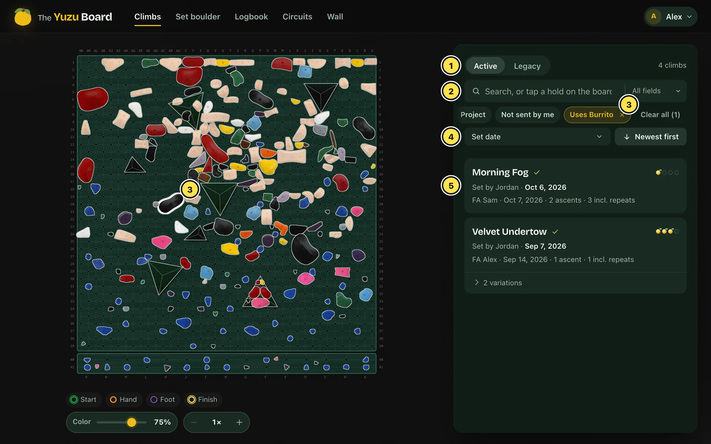

- The search, filters and sort stay put and **only the route list scrolls**. On phones the board, as big as on the Wall tab, stays pinned above the list, and each climb is one line: its name and its yuzus (the setter, ascents and variations are on the climb's page). The board there has no zoom buttons or Color slider (pinch still zooms); set Color on a climb's page, and it stays as you left it.
- ① **Active | Legacy | Drafts** switches between climbable routes, retired ones (every variation uses a removed hold), and climbs saved as drafts (see [Drafts](#drafts)).
- ② Search by problem name, setter, or first ascensionist. Variations match on their base problem's name.
- Filter chips: grade, **Not sent by me**, and the hold you tapped. **Clear all** resets them.
- ③ **Tap any hold** on the board to list every route that uses it.
- ④ **Sort** by set date, difficulty, first ascent date, or number of ascents. Ascents can be counted without repeats (each climber once) or with repeats (every send). The arrow button reverses the order. Unsent climbs always sort last by first ascent date.
- ⑤ Every card shows both ascent counts.
- Hovering a route previews its holds, as in the picture at the top.
- A **yuzu slice** marks every climb you have sent (choose who you are at the top right), and **half a slice** marks one where you have sent a variation, even if the filters hide that variation.
- Filters and sort are remembered in your browser. Coming back from a route, the last climb you looked at (after any swipes) stays on the board and its row keeps a faint yellow outline.
- **On phones** the controls fold into one row: search plus a **Filters** button (its badge counts the filters that are on). Filters opens a sheet with Active | Legacy | Drafts, the search box and what it looks in, the filter chips and the sort. Filters that are on show as small removable chips under the search.
- **On phones the list is a sheet under the board.** Swipe it up to cover the board and see more climbs, and swipe it down (on its top part, or on the list once it's at the top) to lower it again. Tapping the search raises it too, so the box stays above the keyboard; in the Filters sheet, the sheet fills the screen while you type.
- **On phones, tap a climb to show it on the board**: its row gets a faint yellow outline. Tap it again, or its **›**, to open it. A climb picked from the raised sheet lowers it, with that climb as the top row; coming back from a climb, it is the top row too. **Swipe the board** left or right to step to the next or previous climb in the list, as on a climb's page: it goes on the board, outlined, as the top row.

 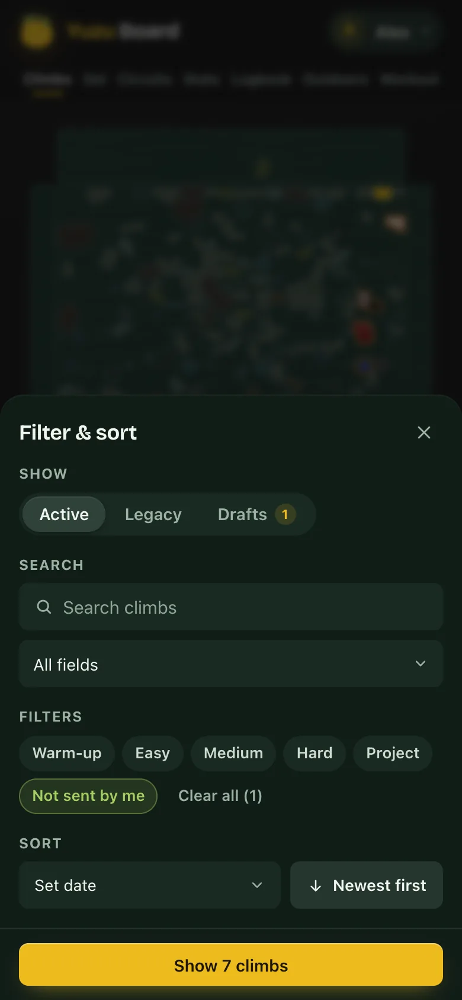

### Route page


- Shows the holds, each ringed in its role's color and shape: leaf green `#16A34A` = start (double ring), zest orange `#FF8A1F` = hand (bold ring), blossom violet `#B866FF` = foot (thin ring), yuzu yellow `#FFE14D` = finish (double ring). A dark gap keeps each ring apart from the hold's own color, and the rings stay the same width on screen at any zoom. On phones, where the board is small, every role gets the same single thin ring, told apart by color.

  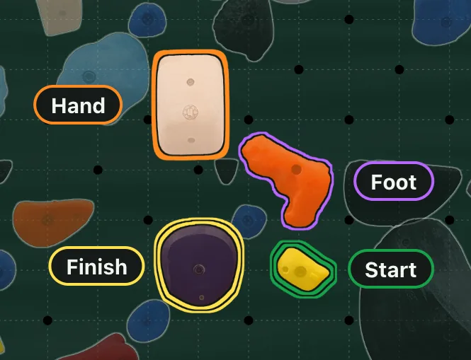

- ① **Variations** lists the original problem and its variations in a box of rows like the Climbs list: each with its grade and, if you have sent it, a yuzu slice; the one you're on is outlined. Tap a row to open it; **+ Add a variation** is the last row. The label counts the variations you have sent.
- ② The hold counts under **Holds** double as a legend: tap one (say, **Foot**) to fade the route's other holds, and tap it again to show them all.

   

- Under the holds, **Circuits** names the circuits the climb is in (tap one to open it), and the setter's notes follow.
- ③ **Log send** (or **Log repeat**) takes a date and an optional comment. The first send of a route automatically records the first ascent.
- ④ **Add to circuit** puts the climb in one or more circuits (see [Circuits](#circuits)).
- ⑤ The Ascents list shows each climber once, with the date of their first send.
- **Mark tried** says you tried the climb today (or on the date you pick), sent or not, with an optional note on what you learned. It's one mark a day, not a count of attempts; marking it again that day updates the note. Once marked, the button reads **✓ Tried today**, and tapping it lets you change the note or remove the mark.
- **Your sessions** lists your tries and sends on the climb, newest first, with their notes and comments, so the beta you worked out last week is there when you come back to it.
- **Move to drafts** (only while nobody has sent the climb) takes it back to [Drafts](#drafts) to finish setting, with its name, grade, setter, set date, notes and holds. It comes out of any circuits it was in. A problem with variations stays put, since they would have nothing to hang off.
- **On phones** the page scrolls as on the Wall tab: the board on top, the same size as on the Climbs list, and the climb's details below it. So going between the list and a climb, or on to the next climb, changes only the climb's holds; the board keeps its size.
- **On phones, swipe the wall** left for the next problem in the Climbs list (same filters and sort) and right for the previous one; variations are skipped. The climb's holds slide with your finger while the wall and the other holds stay put. ⑥ A **‹ Climbs · 3 of 7 ›** bar does the same with taps, and ⑦ **← All climbs** above it goes back to the filtered list. Opened from a circuit, swiping steps through the circuit instead.

 

### Set boulder

On phones this tab reads **Set**, so all the tabs fit on one row.


- ① Choose a hold type and tap holds to paint them. Number keys 1–5 switch the type.
- Painted holds get their role's ring (as on the route page) in place of the white border. Once a hold is painted, the others fade to half strength (and light up under the pointer), and so do the volumes' borders. ② **Fade other holds** (or **F**) switches the fading off and on; your choice is remembered in this browser.
- ③ Give the route a name, roll 🎲 for one, or leave it blank to get a random name.
- ④ Pick a grade: warm-up, easy, medium, hard, or project. Each has its rough V range under it (see [Grades](#grades)).
- **Save draft** keeps a new boulder or variation as it is, to finish later (see [Drafts](#drafts)). The name and set date can still be blank, and it needs no start or finish yet.
- In edit mode, every field can be changed, including the first ascent.

### Circuits


Playlists of climbs to do as a set, in order. Circuits are shared: everyone sees them, each one shows who made it, and ② you see how many of its climbs you have sent.

- **New circuit** asks for a name, then opens the circuit ready to add climbs.
- ③ **Add climbs:** search, or tap a hold on the board to list the climbs that use it. **Add** puts a climb at the end; **Added** takes it out again. Variations can be added too.

  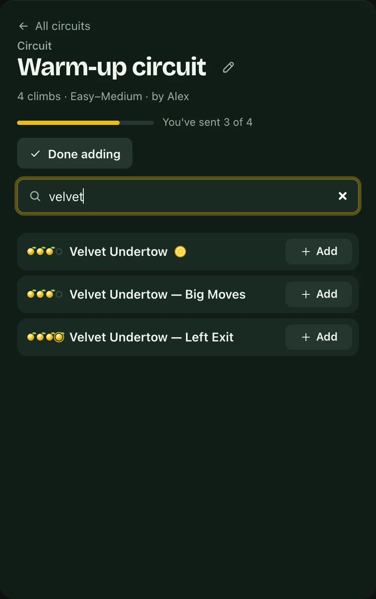

- ④ The arrows reorder climbs, × removes one, and ① the pencil renames the circuit. **Delete circuit** removes only the circuit, never the climbs.
- ⑤ Hovering a climb shows it on the wall.
- Opening a climb from a circuit shows a **‹ circuit · 3 of 6 ›** bar to step through it. Above it, **← All circuits › circuit** goes back to the list of circuits or to this circuit's climbs (so does tapping the name in the bar). A circuit itself has the same **← All circuits** link at the top.
- From any route page, **Add to circuit** ticks the circuits it belongs in, or starts a new one with it.
- A climb that loses a hold stays in its circuits, marked "Not possible", but can't be added to new ones. Deleting a route removes it from its circuits.

### Logbook


A month calendar takes the wall's place: beside the log on a computer, above it on a phone. Days you climbed are tinted yuzu, with a yuzu dot. A day's color says what kind of day it was, never how much: more sends don't make a better session. Beside the month's name it counts the days you climbed (and, for the admin, the workouts). ‹ › step through the months and **Today** comes back. Tap a day to open it in the log below; the other days close. For the admin the calendar also tints outdoor days sandstone and workout days blue, each with its own dot. A day with two kinds of session, say a workout and an outdoor climb, splits into two smaller rectangles side by side, one in each color (three for all three), with a dot for each. A day with only a workout opens that workout.

Below the calendar is your log, newest first, grouped by day under each month: every day is a dropdown that says what happened, without counts ("sent · repeated · tried"), the latest one open. Days you open or close stay that way while the app is open. The stats and toggle stay put while the log scrolls. Repeats have an amber border, first sends a green one, and tries a gray one, with their notes. Sends on retired climbs get a "Legacy" tag. Each send and try can be edited or deleted.

**Fingers** (the admin only): the **Fingers** button under the totals opens a check. Score how each finger feels, from 0 (healthy) to 10 (most painful), at the **start** and **end** of a session. On a rest day log just the end. Your fingers show as ten fingertips, seen as your hands on a table: the left hand on the left, the middle fingers highest and the thumbs low and in. Tap a fingertip, then its score on the row below (on a computer, keys 0–9 do it too, and 1 then 0 quickly makes 10), and write how they feel. A new check starts from the scores of your last one (for an end check, that day's start), shown above the fingertips with its date, sorest finger and comment; your very first starts every finger at 0. A healthy finger is a quiet gray dot, and pain colors it from blue (1) to red (10), so only what hurts stands out. Under the form, **History** lists every check, newest first, as a row of its ten scores (the fingers in the order they're drawn, pinky to thumb then thumb to pinky); tap a row to open that check. On the calendar a logged day shows the fingertips on a band of their own along its bottom, under the day's colors (so a day split between kinds of session never runs behind them), by the end-of-session scores (or the start's, until the end is logged); hover them for the day's comments, and point at one fingertip for its score at the start and end. In the log, the day lists both checks with their sorest finger (point at a fingertip for its score); the pencil edits them. Nothing moves.

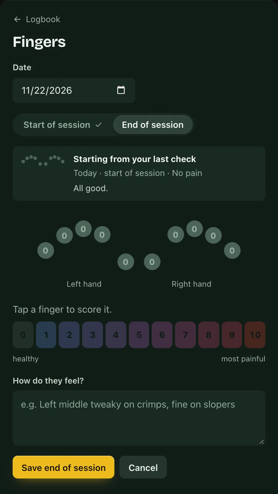

**Outdoor climbs** (the admin only) show on their days too, logged on the [Outdoors](#outdoors) tab. Each climb from a session is one line, like a home-board send: its name, grade, which session on it this was ("V12 · Session 5"), a **Tried** tag if you didn't send it, and its note, with a sandstone border. The name opens the climb's page; the pencil opens the session.

### Outdoors

Only the admin sees this tab (see [The admin login](#the-admin-login)). It has no calendar; the Logbook's shows your days out.

- **In progress | Sent** switch between the climbs you haven't sent yet, most recently tried first, and the ones you have, newest send first, with how many of each. An in-progress climb shows its grade, area and sessions so far ("5 sessions · last Nov 17"). A sent one gets the yuzu slice and says how long it took ("Sent Nov 14 · took 2 sessions"). Search finds climbs or areas in either list.
- **+ Session** logs a day outside: the date, the area, notes on the day, and the climbs you tried.
  - **Area** drops down the areas you've been, the latest first, with how many climbs you've logged in each. Pick one or type a new one.
  - **Add a climb** drops down that area's climbs you haven't sent as soon as you tap it, the latest tried first. Tap one to add it; the list stays open for the next. If the Area is still empty, picking a climb fills it in with that climb's area. Typing narrows the list, then shows climbs of that name in other areas and offers it as a **New climb** in this area. A sent climb shows (with the yuzu slice) only once you type its whole name, to log it again. On a computer, arrows and Enter pick, and Esc closes.
  - Mark each climb **Tried** or **Sent** and note what you learned on it. A new climb also takes its grade (free text, such as V5 or 6B+) and **Sessions before**: how many sessions you'd had on it before logging it here (see the session count below). A known climb has an **Earlier notes** dropdown with its notes from past sessions.
- **A climb's page** (tap it in either list) shows how many sessions you've spent on it and when you sent it, on which session. **Notes by session** lists every session on it, newest first: its date, number and area, **Sent** or **Tried**, your note on the climb, and the day's notes from that session. Tap a date to open that session to edit or delete it. **Edit** changes the climb's name, area, grade, sessions before logging here and general notes. Coming back to the list keeps your place in it.

  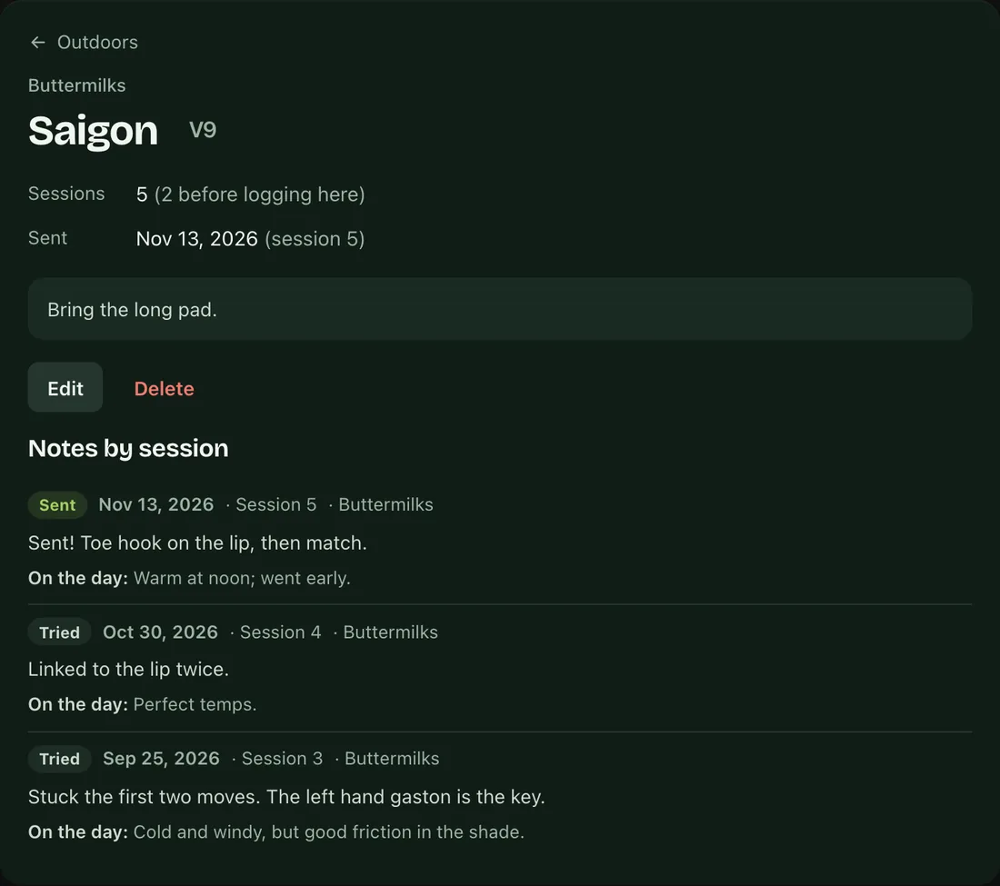

- **Session count:** each session on a climb is numbered by date. A climb is its name in its area, so a boulder of the same name at another crag keeps its own count. If you'd been on a climb before you started logging it here, set **Sessions before** when you add it to a session (or **Sessions before logging here** on its page later) and the logged ones count on from there: with 4, the first logged session is its 5th.

### Workout

Only the admin sees this tab (see [The admin login](#the-admin-login)). **Workout** and **Exercises** at the top switch between the day's workout and the exercise list. Both are for the same day, and **Workout** counts its exercises. The calendar stays put as you go between them.

- **The calendar** is small, on the right of the page; on a phone it's a short one above the workout. It marks only your workout days, in blue, and counts them under the month's name. ‹ › step through the months and **Today** comes back. Tap a day to open its workout, or to log one after the fact. Under it on a computer, the month is summed up: your **average tiredness** and the exercises you **did most**, each with its number of days (tap one to open it). Point at an exercise there or in the Exercises list and its days light up in full blue, the other workouts fade back, and the count under the month says how many days you did it. An exercise's own page keeps its days lit.
- **A day's workout:** each exercise is a card, two to a row on a computer, with a row per set. What you type is saved as you go. **+ Set** adds a set copying the one before, so a repeat set is one tap. Each card shows **Last time** (the sets from the last day you did that exercise and variant) and the **30-day best** (the best set of the 30 days before this one), to beat. Beside them, a small line shows each earlier day's best (the last 12 days); point at it to see where it went from and to. Rate how tired the session felt from **1 Fresh** to **5 Wrecked**, and add notes. There's one workout a day; an empty one is dropped. **Add exercise** opens the Exercises list for that day.

  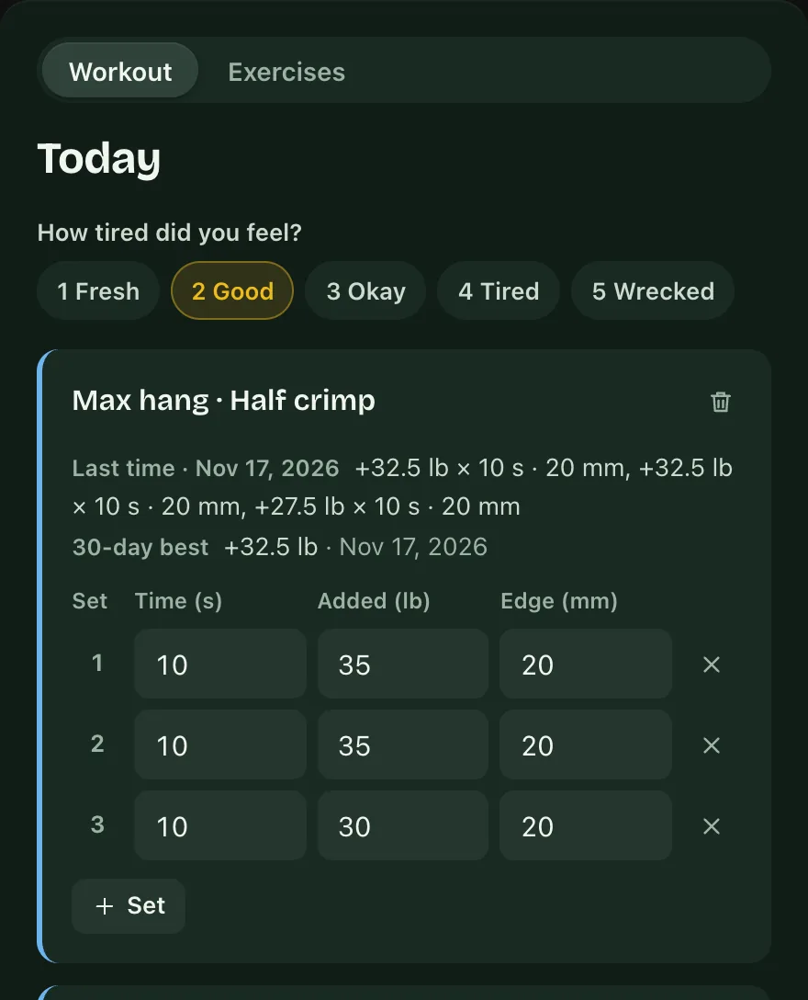

- **How sets are measured** depends on the exercise: **Weight × reps** (a lift), **Bodyweight reps** (with optional added weight), **Timed hold** (seconds, with optional added weight) or **Hang** (seconds, added weight and edge depth in mm). Weights are in pounds. Added weight can be negative for assistance, such as a pulley taking weight off a hang.
- **Exercises** is where you add to the day's workout; it says which one ("Adding to today's workout"). At the top, **Recent** has one-tap buttons for what you've done in the last two weeks. Below the search box, exercises are in alphabetical order, two to a row on a computer. Each shows when you last did it (or **Not done yet**) on the right, and a bar of buttons, one per variant (Barbell or Dumbbell bench press, a hang's grips), so one tap adds both. Each button says when you last did that variant. One already in the workout reads **✓ Added**, and you stay on the list to add the next. **+ Variant** at the end of the bar (just **+** on a phone) adds a new variant to the exercise (say, Incline bench press) and puts it in the workout straight away. An exercise done without a variant before it had any keeps that as a **Standard** button. An exercise's name opens its page. **New exercise** adds one to the list. The app starts with common ones (bench press, overhead press, deadlift, squat, row, pull-up, push-up, dip, plank, L-sit, max hang).
- **An exercise's page** charts your progress: one small chart per variant, each day's best set over time. Hover or tap a point (or use the arrow keys) for its value, date and, for hangs, the edge. A variant's chart shows the heaviest set once any set has had weight added (an unweighted set counts as +0 lb); until then it's the most reps for bodyweight exercises and the longest hold for timed holds and hangs. The history below lists every session's sets. Variants can be added, renamed, or deleted while unused. An exercise that has been done can't be deleted or change how it's measured.

  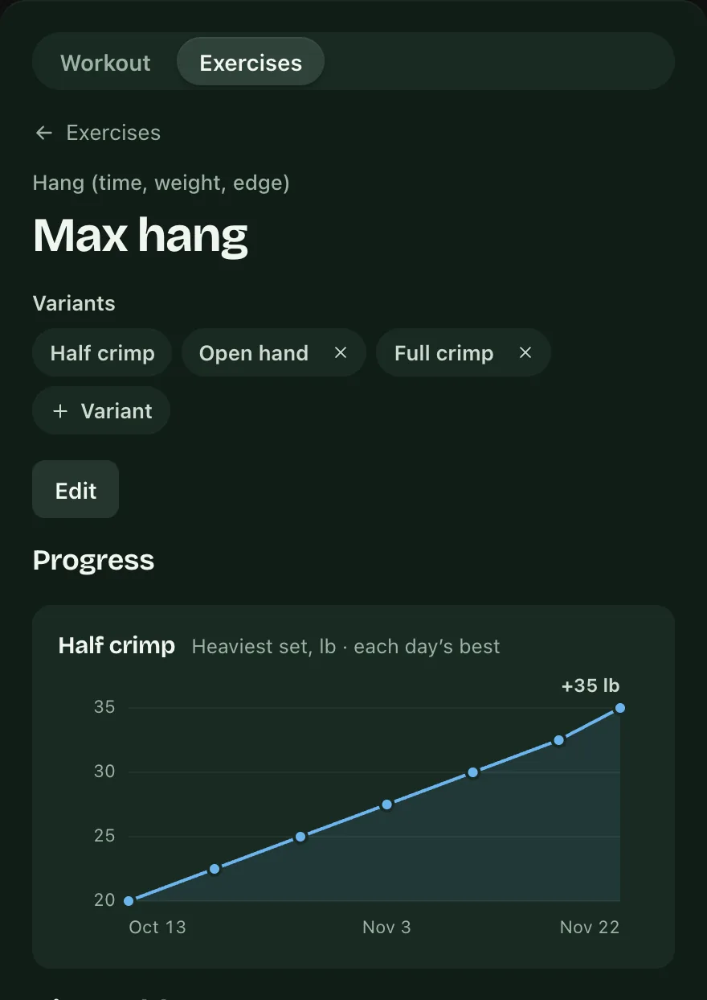

### Wall

Manage the physical holds. This tab is on computers only: phones don't show it, since holds aren't added or removed from a phone.

#### Add a hold

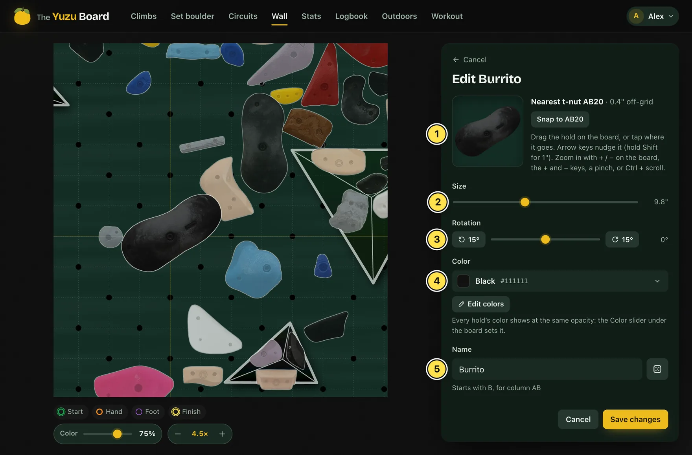

Upload a transparent PNG. Transparent margins are trimmed automatically. The same editor opens for a hold that is already on the wall, as above.

- Drag it on the board or tap where it goes. Arrow keys nudge it (Shift for 1").
- **Zoom in** to place it precisely (see Zoom above). While placing, dragging the hold to the board's edge pans the view, and the view follows the hold after a nudge or snap. The zoom carries over from picking a hold to placing it.
- ① The panel shows the nearest t‑nut, with a **Snap** button. On a side panel it says which panel instead, and on the ceiling which column (no t‑nuts on either, so no Snap). Dragging into a gap between panels lands the hold on the nearer one.
- Adjust ② **size** and ③ **rotation**. ④ Pick a **color** from the color list, where each color shows its square, name and value (e.g. Red `#7A0404`), or Custom…. The board and the preview update live. **Edit colors** opens the color list (see below).
- ⑤ A name is suggested for the column's letter (L or R on a side panel; on the ceiling, the column it's under). 🎲 rerolls it; a name you type must start with the same letter.
- No two holds share a name (ignoring case), removed holds included, so a removed hold always comes back under its own name. To reuse a removed hold's name, delete that hold permanently first.

#### Recolor holds

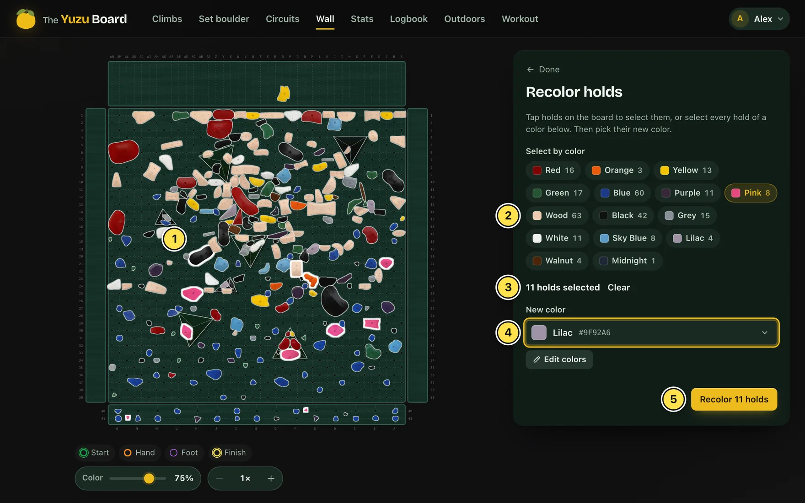

Gives many holds a new color at once:

- ① Tap holds on the board to select them (tap again to unselect), or ② tap a color under **Select by color** to select every hold in it.
- ③ The count shows how many are selected; **Clear** unselects them.
- ④ Pick the new color (or None for the photo's own colors) and ⑤ press **Recolor N holds**. Done or Esc leaves.

#### The color list


The color list is shared by everyone. **Edit colors** (in the hold editor and in Recolor holds) lists each color with how many holds use it.

- **Edit** changes a color's name or value. Type the value as **HEX** (`#1E3A8A`, `1e3a8a` or `#abc`) or **RGB** (three numbers, 0–255), or pick it from the swatch. Changing a color's value recolors every hold in it.
- **Add a color** adds a new one at the end. Names and values must be unique.
- **×** removes a color, offered only while no hold on the wall uses it.

#### Tap a hold

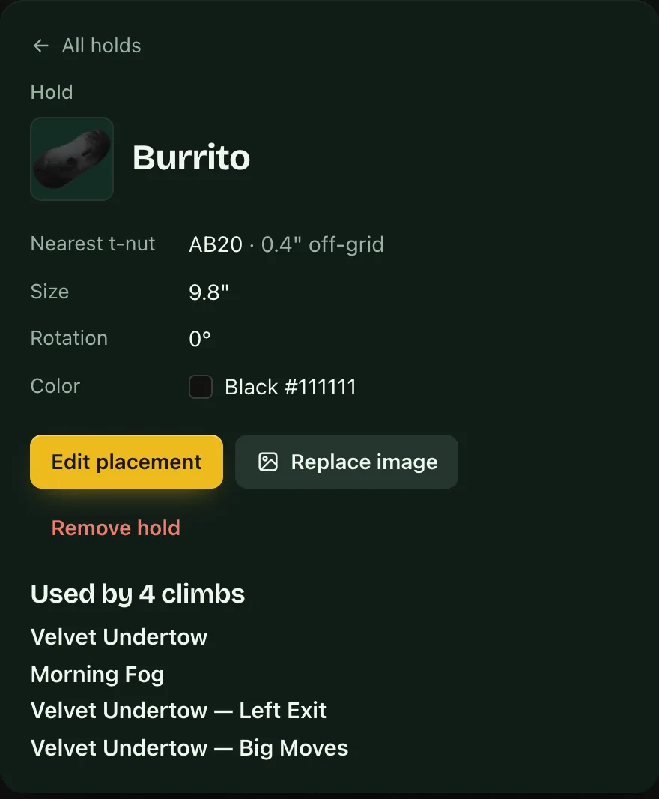

Tap a hold to see which climbs use it. From there you can edit its placement or color, add or replace its image, or **remove** it. The demo placeholder circles can get an image this way and keep all their routes.

#### Removing a hold


- A confirmation lists the routes that will move to Legacy and the families that will only lose some variations.
- A family where at least one variation can still be climbed stays in Climbs. It gets a "not all variations are possible" warning, and the impossible variations are greyed out, can't be logged, and show the removed hold as a red-ringed ghost.

  

  ① The removed hold, as a red-ringed ghost. ② Why the climb is no longer possible. ③ **Log send** and **Mark tried** are turned off.

- Removed holds can be restored from the same tab, which brings their routes back.
- **Delete permanently** (next to Restore) deletes a removed hold and its photo for good. It only works once no climb uses the hold, Legacy ones included; otherwise it lists the climbs in the way, to delete or edit first.
- Retired routes are under **Climbs → Legacy**.

   

  Left: the family warning in Climbs. Right: Climbs → Legacy.

#### Volumes


Wooden volumes are part of the wall's background.

- **＋ Add a volume**, then click the corners in order. They can go anywhere on one panel (the main board, the footboard or a side panel; not the ceiling), not just on t‑nuts; ② snapping to t‑nuts is optional (the side panels have none).
- ① **Drag any corner** to move it, including ones placed earlier; pressing anywhere else adds the next corner. Backspace undoes the last corner, Enter saves, Esc cancels.
- Choose **Black** or **Dark green** (a truer, darker green than the wall). Every volume has an off-white border, hidden wherever a hold sits on top, and a soft shadow.
- ③ **Faces:** a volume's sides can be drawn inside it as fine lines, so its 3D shape reads on the flat board. In the volume editor, **Add a face**, then click its corners. Clicks snap to a nearby corner first (the volume's or another face's), then to a nearby edge. Click its first corner again, press Enter or **Done** to finish. Backspace removes its last corner, Esc cancels it, and × in the list deletes a face. Moving a corner moves every face corner attached to it. Face lines are much thinner than the border and never thicken it where they run along it, and holds on top hide them.
- The grid stays faintly visible through a volume, at half strength.
- Volumes have no names, can't be selected as holds, and never appear in routes. The Wall tab lists them under **Volumes on the wall**, a dropdown closed by default. In the list, **Edit** reopens a volume to move its corners or change its color; **Delete** removes it.

### Stats

How often each hold is used. Every active climb counts once for each hold on it, whatever its role; variations count as climbs of their own, and legacy climbs don't count.

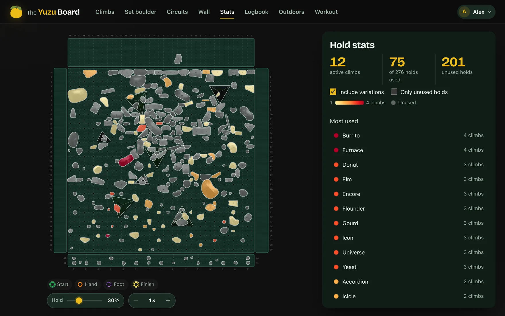

- **Include variations** (on by default) can be turned off to count only the original problems. The colors, numbers, key and list all follow it.
- Each hold is drawn in gray under its usage color: light yellow for one climb, through orange, to dark red for the most used hold. Holds on no climb stay a darker gray.
- The slider under the board reads **Hold** here instead of Color: how much of the hold itself shows through its usage color, from flat color at 0% to the plain gray hold at 100%. The gray keeps a hold's own color from mixing with the scale.
- **Only unused holds** keeps the unused holds bright and dims the rest, as showing a route does.
- Hover a hold (or tap it on a phone) to see how many climbs use it. The list below the stats ranks the holds by use, or lists the unused ones; hovering a row outlines that hold on the wall.

### Legacy

The switch at the top of Climbs: routes where every variation uses a removed hold. Editing one and swapping out the removed hold brings it back to Active.

### Drafts

The third switch at the top of Climbs: boulders and variations saved with **Save draft** and not published yet. Drafts are shared, so everyone sees the same list, on any device.

- Each card shows the grade, the name (or *Untitled draft*), what it's a variation of, who saved it last and when, and how many holds it has, plus whether it still needs a start or finish. Hovering a card previews its holds.
- Tap a draft to pick up the Set boulder form where it was left. **Save draft** keeps the changes; **Save route** publishes it as a climb, and the draft goes. **Delete draft** (under the title) throws it away.
- A climb nobody has sent yet can come back here with **Move to drafts** on its route page.
- Drafts stay out of Active, Legacy, Stats, circuits and the logbook until they are published. Holds removed from the wall since a draft was saved are left out when it is reopened.

## Look & feel

"Midnight Grove": a neutral near-black page, a dark forest-green panel, and a spruce-green wall that stands apart from the page. Yuzu is the single accent color, and the hold-role colors are reserved for the board.

- **Type:** headings use **Bricolage Grotesque**, stored in `static/fonts/` under the SIL Open Font License, so it works offline. Body text uses the system font.
- **Grades:** shown as one to four little yuzu, from Easy ●○○○ to Project ●●●●. **Warm-up**, below Easy, is a leaf sprouting from a mound of soil: the stem grows up, its two leaves unfold and sway, and it sinks back to grow again. Where a grade is in the spotlight (a climb's Grade line, the grade picked in Set boulder, and the climb on the Climbs list's board) its yuzu fall from the tree and roll into place, one after another, each time it comes into view; Project's ringed fourth then drops into its ring and glows. Everywhere else they stay still. Where a grade's V range is spelled out (see [Grades](#grades)), it's in small muted type.

  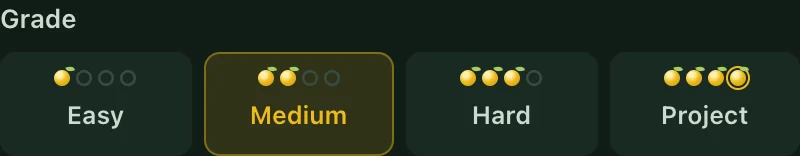

- **The wall:** dark plywood with a faint wood grain. Placeholder holds look like small resin dots.
- **Holds:** every hold shows its color at the same opacity, 75% by default, with a thin white border (about ¾ of a screen pixel at any zoom). The **Color** slider under the board, beside the zoom, changes the opacity for all holds at once, so the photos show through; it's remembered in your browser.
- **On phones and other touch screens** every hold is drawn as part of one picture of the wall that the server makes, with each hold's border and color already in it, instead of hold by hold with filters as on a computer. The holds on a climb are drawn on top of it, with their rings. A phone downloads that one picture instead of hundreds of hold images, and fading the other holds or zooming moves the picture as a whole, so opening climbs, going back to the list and zooming stay quick. On the Stats tab, and while you move a hold on the Wall tab, the holds are drawn one by one again. The border is the same at 1× but grows with the zoom, and the Color slider applies when you let go of it.
- **Celebrations:** logging a send sets off a small burst of yuzu, and a first ascent gets a bigger one. This is skipped when the device asks for reduced motion.
- **Contrast:** all text meets WCAG AA contrast on every surface.

## Layout

```
app.py            the Flask app (registers the blueprints below) and the command line
climbs.py         climbs, variations and drafts; the climb list's filters and sorting; possible vs Legacy
holds.py          holds, the color list and volumes
hold_images.py    uploaded hold PNGs, the board's smaller copies, and the touch screens' picture of the wall
logbook.py        climbers, sends, tries, first ascents and repeats, the calendars' days
circuits.py       circuits
auth.py           the admin login: password, session cookie, `--set-admin`
outdoor.py        the admin's outdoor sessions and climbs
workouts.py       the admin's workouts, exercises, and progress
fingers.py        the admin's finger checks: a score per finger at the start and end of a session
helpers.py        shared by the above: JSON errors, parsing submitted values
constants.py      the grades and hold roles
db.py             SQLite connection helpers + in-place migration of older databases
schema.sql        tables: climbers, holds, routes (parent_id = variation), route_holds, drafts, draft_holds, sends, tries,
                  volumes, circuits, colors, settings, outdoor_climbs/sessions/entries, exercises, exercise_variants,
                  workouts, workout_exercises, workout_sets, finger_checks
geometry.py       board dimensions, t-nut labels, nearest t-nut
hold_names.py     nouns for each letter, used to name holds
seed.py           demo holds, routes, and sends
requirements.txt  Flask and Pillow, and waitress, which serves the app on the Pi
wsgi.py           the app as waitress serves it on the Pi
backup.py         snapshots of the database: taken while the app runs, kept by age, checked
deploy/           pi/: the Pi's installer, services and deploy every 2 minutes; mac/: the sync from the Pi,
                  the test app, failover and status (docs/deploy.md)
uploads/holds/    uploaded hold PNGs, and in board/ the smaller copies the wall draws, sized for each screen (git-ignored)
static/           index.html, css/app.css, fonts/, img/, and js/:
  app.js            starts the app and routes #/ links to pages
  api.js            every call to the server
  ui.js             building elements, dialogs, toasts, dates, grades
  board.js          the SVG wall; viewport.js its zoom and pan
  calendar.js, chart.js, hands.js, palette.js, sheet.js, swipe.js, icons.js, names.js
                    the month calendar, progress charts, finger-check hands, color list, phones' list sheet,
                    swiping between climbs, the icon set, random route names
  views/            one module per page; views/holds/ the Wall tab's tools; views/shared.js what pages share
tests/            the server's tests (stdlib unittest); support.py has what they share
docs/             development.md (working on the code), deploy.md (the Pi and the Mac), hold-lighting-research.md
                  (lighting a climb's holds with projectors), img/ (README screenshots and diagrams)
```
