# The Yuzu Board


A route tracker for a home bouldering board. It draws the wall to scale and lets you set boulders by tagging holds. It also keeps a shared logbook of sends, repeats, and first ascents.

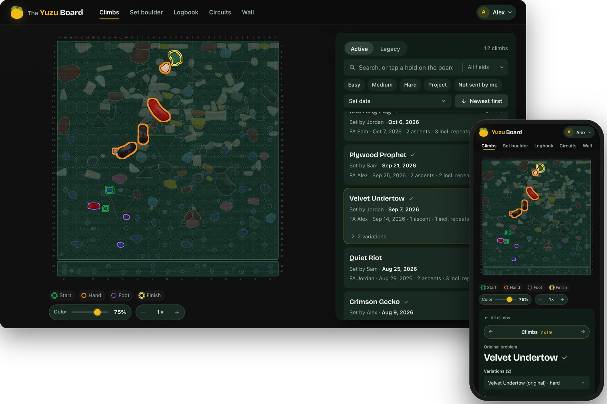

## Run it

```sh
python3 -m venv .venv
.venv/bin/pip install -r requirements.txt
.venv/bin/python app.py
```

Then open <http://localhost:5050>. The server listens on all interfaces, so phones on the same Wi‑Fi can use `http://<your-mac's-IP>:5050`. On the first run the database (`homewall.db`) is created and filled with demo data.


- Reset to fresh demo data: `.venv/bin/python seed.py --reset`
- Run the tests: `.venv/bin/python -m unittest discover tests`

## The wall

| | |
|---|---|
| T-nut grid | 40 columns × 39 rows, 3" apart |
| Columns | lettered **right → left**: `A` … `Z`, `AA` … `AN` |
| Rows | numbered **top → bottom**: `1` … `39` |
| First hole (`A1`) | 1.5" from the right edge, 2.75" from the top |
| Wall size | 120" × 118.75" (1.5" past the last column, 2" past the last row) |
| **Footboard** | 120" × 8", drawn 1" below the main panel |
| Footboard t-nuts | 15 columns × 2 rows: columns 8" apart starting 4" from the right, lettered **A′ … O′** right → left; rows **40** and **41**, 2.5" from the footboard's top and bottom |


The geometry lives in `geometry.py` and is served to the browser at `/api/board`. Holds store a free `x, y` position in inches, so they can sit anywhere on the main board or the footboard, not just on a t‑nut. Each hold also records its **nearest** t‑nut, and its name is a noun starting with that column's letter. For AA…AN the name starts with the second letter, so a hold near AB9 might be "Biscuit". On the footboard, C′ gives a C noun. Hovering a hold shows its name.

## Using it

The numbered markers in a screenshot (①, ②, …) match the numbered points that follow it. The screenshots show demo climbs on the real wall.

### Climbing as and zoom


- **Climbing as:** pick yourself in the top-right corner. There are no passwords. You can add new climbers from the same menu.
- **Zoom (every view of the board):** up to 6×, or 2.5× on phones and other touch screens. ① The **− 1× +** buttons on the board and the + / − keys zoom around the middle of the view; Ctrl + scroll or a pinch zooms where you point. Tap the level (or press 0) for the whole wall. Zoomed in, drag (or scroll) to pan; a tap still picks a hold. A quick drag keeps gliding and slows to a stop; touching the board stops it. While you pinch, the wall stretches and is drawn sharp again once your fingers lift. On phones, one finger scrolls the page as usual until you zoom in, and on a climb's page the swipe to the next climb works whenever the board isn't zoomed. Each new page starts from the whole wall.
- ② Hovering a hold shows its name under the board.

### Climbs


- The search, filters and sort stay put and **only the route list scrolls**. On phones the board stays pinned above the list.
- ① **Active | Legacy** switches between climbable routes and retired ones (every variation uses a removed hold).
- ② Search by problem name, setter, or first ascensionist. Variations match on their base problem's name.
- Filter chips: grade, **Not sent by me**, and the hold you tapped. **Clear all** resets them.
- ③ **Tap any hold** on the board to list every route that uses it.
- ④ **Sort** by set date, difficulty, first ascent date, or number of ascents. Ascents can be counted without repeats (each climber once) or with repeats (every send). The arrow button reverses the order. Unsent climbs always sort last by first ascent date.
- ⑤ Every card shows both ascent counts.
- Hovering a route previews its holds, as in the picture at the top.
- Filters and sort are remembered in your browser. Coming back from a route returns you to the same spot in the list, with the route you opened briefly outlined.
- **On phones** the controls fold into one row: search plus a **Filters** button (its badge counts the filters that are on). Filters opens a sheet with Active | Legacy, what the search looks in, the filter chips and the sort. Filters that are on show as small removable chips under the search.

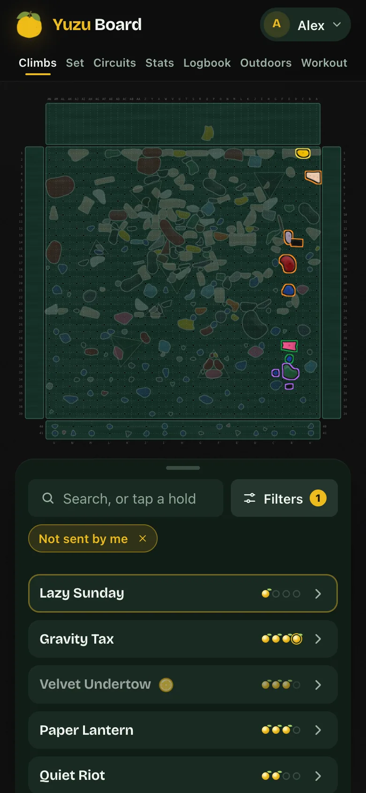 
### Route page

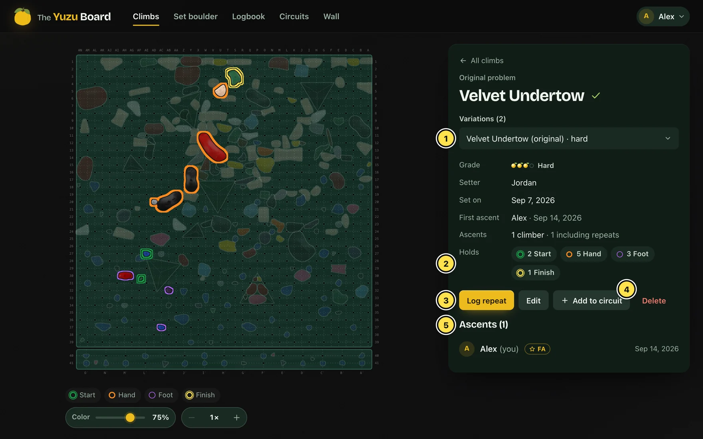

- Shows the holds, each ringed in its role's color and shape: leaf green `#16A34A` = start (double ring), zest orange `#FF8A1F` = hand (bold ring), blossom violet `#B866FF` = foot (thin ring), yuzu yellow `#FFE14D` = finish (double ring). A dark gap keeps each ring apart from the hold's own color, and the rings stay the same width on screen at any zoom.

  

- ① A dropdown switches between the original problem and its variations, or adds a new one.
- ② The hold counts under **Holds** double as a legend: tap one (say, **Foot**) to fade the route's other holds, and tap it again to show them all.

  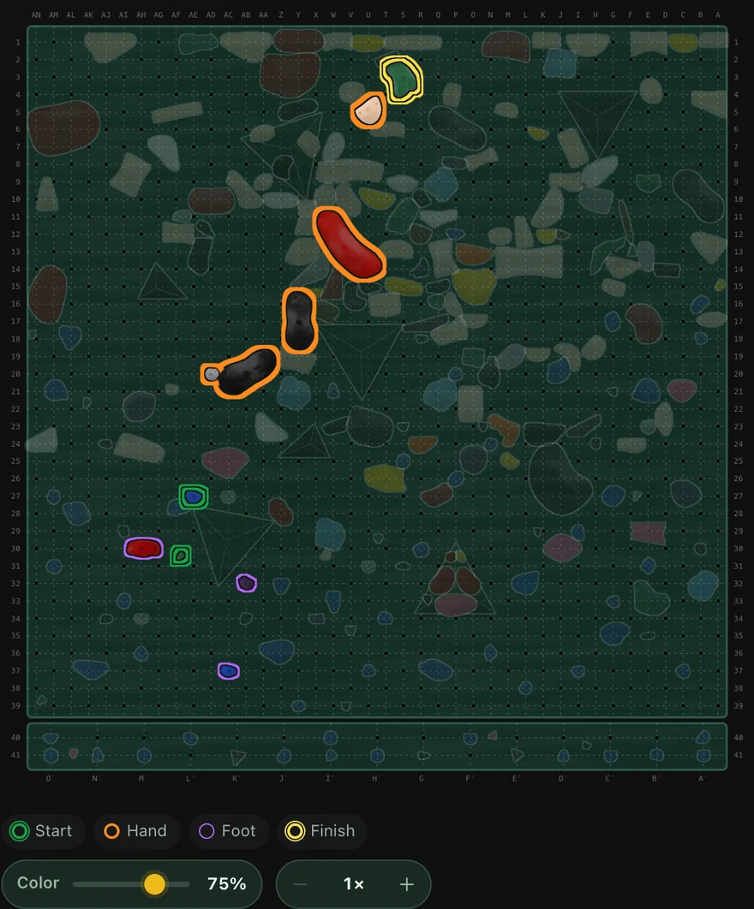 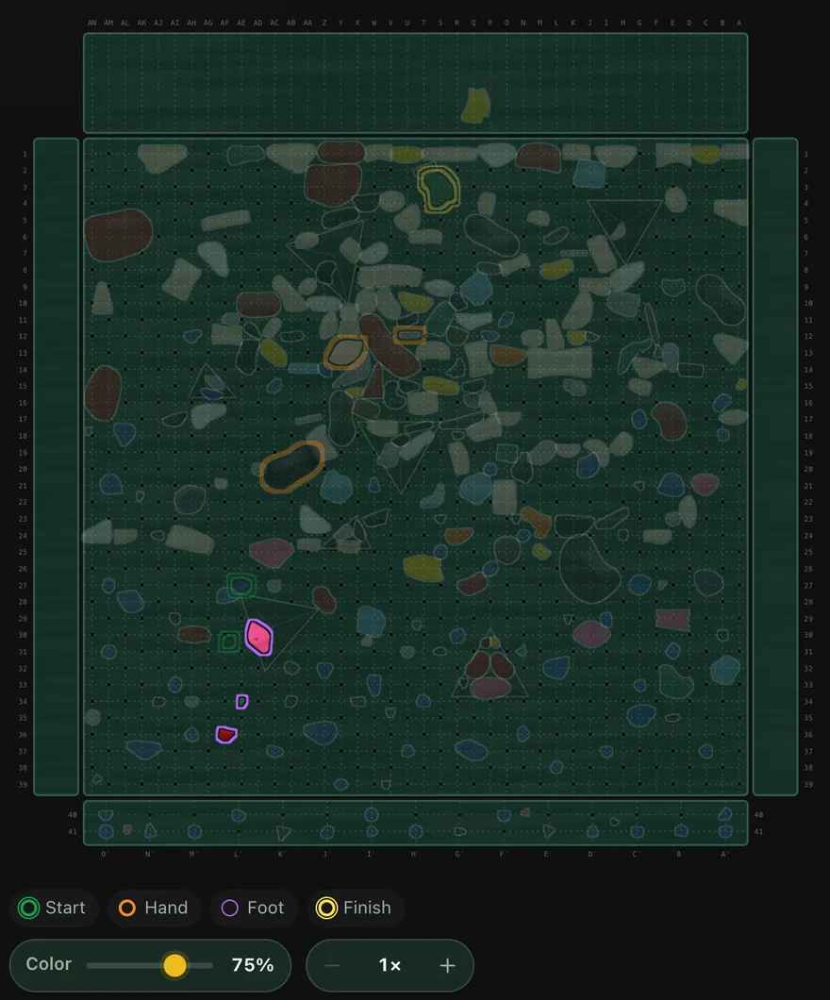

- ③ **Log send** (or **Log repeat**) takes a date and an optional comment. The first send of a route automatically records the first ascent.
- ④ **Add to circuit** puts the climb in one or more circuits (see [Circuits](#circuits)).
- ⑤ The Ascents list shows each climber once, with the date of their first send.
- **On phones, swipe the wall** left for the next problem in the Climbs list (same filters and sort) and right for the previous one; variations are skipped. ⑥ A **‹ Climbs · 3 of 7 ›** bar does the same with taps, and ⑦ **← All climbs** above it goes back to the filtered list. Opened from a circuit, swiping steps through the circuit instead.

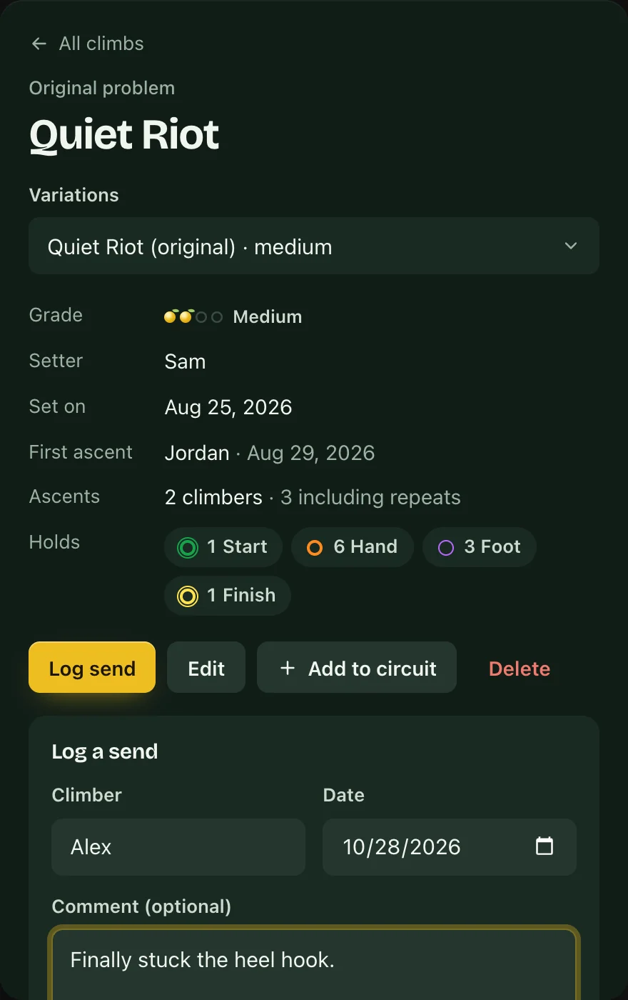 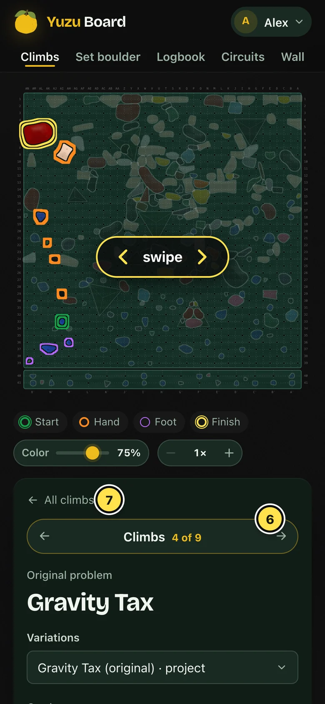

### Set boulder

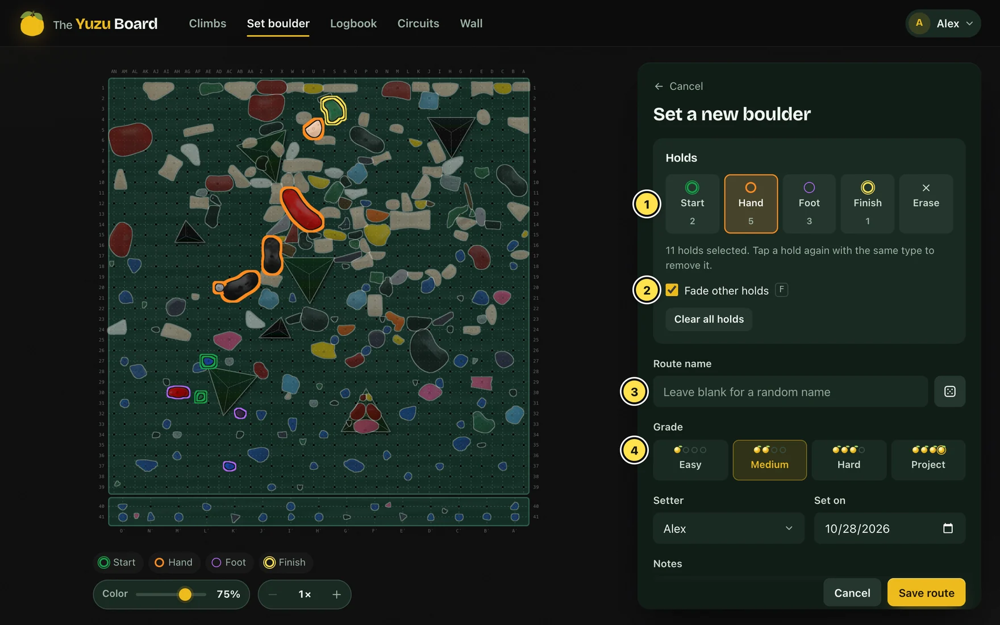

- ① Choose a hold type and tap holds to paint them. Number keys 1–5 switch the type.
- Painted holds get their role's ring (as on the route page) in place of the white border. Once a hold is painted, the others fade to half strength (and light up under the pointer), and so do the volumes' borders. ② **Fade other holds** (or **F**) switches the fading off and on; your choice is remembered in this browser.
- ③ Give the route a name, roll 🎲 for one, or leave it blank to get a random name.
- ④ Pick a grade: easy, medium, hard, or project.
- In edit mode, every field can be changed, including the first ascent.
### Circuits

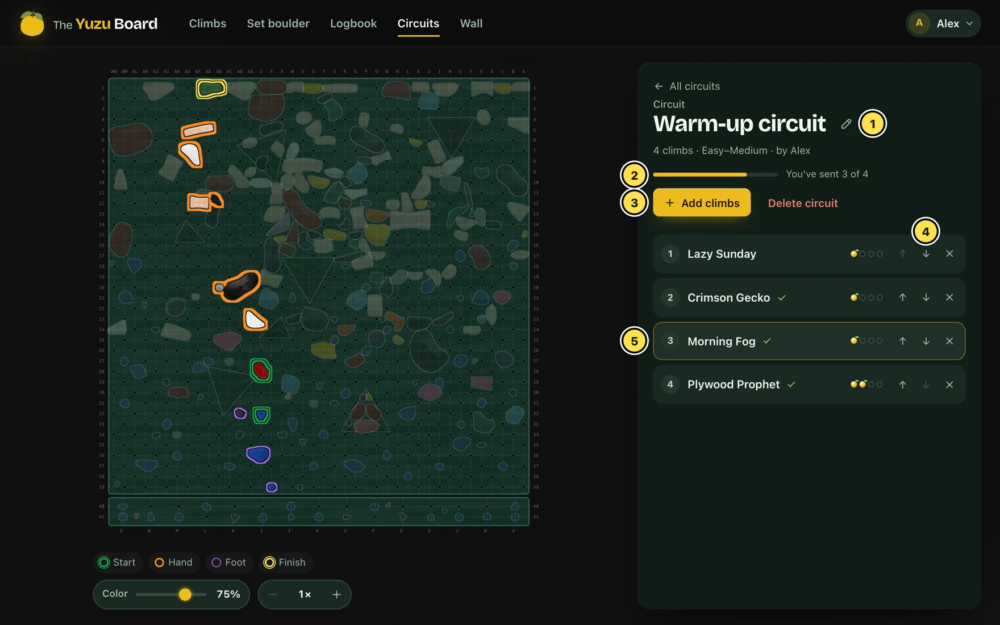

Playlists of climbs to do as a set, in order. Circuits are shared: everyone sees them, each one shows who made it, and ② you see how many of its climbs you have sent.

- **New circuit** asks for a name, then opens the circuit ready to add climbs.
- ③ **Add climbs:** search, or tap a hold on the board to list the climbs that use it. **Add** puts a climb at the end; **Added** takes it out again. Variations can be added too.

  

- ④ The arrows reorder climbs, × removes one, and ① the pencil renames the circuit. **Delete circuit** removes only the circuit, never the climbs.
- ⑤ Hovering a climb shows it on the wall.
- Opening a climb from a circuit shows a **‹ circuit · 3 of 6 ›** bar to step through it.
- From any route page, **Add to circuit** ticks the circuits it belongs in, or starts a new one with it.
- A climb that loses a hold stays in its circuits, marked "Not possible", but can't be added to new ones. Deleting a route removes it from its circuits.

### Logbook

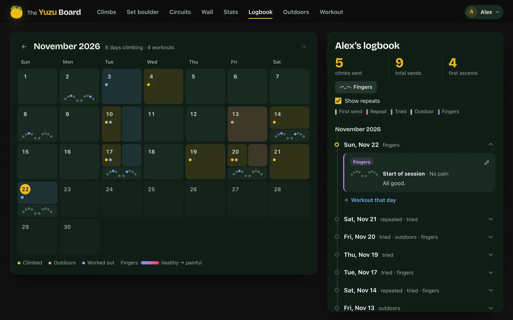

Your sends, newest first; the stats and toggle stay put while the log scrolls. Repeats have an amber border, first sends a green one. Sends on retired climbs get a "Legacy" tag. Each send can be edited or deleted.
### Wall

Manage the physical holds.

#### Add a hold


Upload a transparent PNG. Transparent margins are trimmed automatically. The same editor opens for a hold that is already on the wall, as above.

- Drag it on the board or tap where it goes. Arrow keys nudge it (Shift for 1").
- **Zoom in** to place it precisely (see Zoom above). While placing, dragging the hold to the board's edge pans the view, and the view follows the hold after a nudge or snap. The zoom carries over from picking a hold to placing it.
- ① The panel shows the nearest t‑nut, with a **Snap** button.
- Adjust ② **size** and ③ **rotation**. ④ Pick a **color** from the color list, where each color shows its square, name and value (e.g. Red `#7A0404`), or Custom…. The board and the preview update live. **Edit colors** opens the color list (see below).
- ⑤ A name is suggested for the column's letter. 🎲 rerolls it; a name you type must start with the same letter.
- No two holds share a name (ignoring case), removed holds included, so a removed hold always comes back under its own name. To reuse a removed hold's name, delete that hold permanently first.

#### Recolor holds


Gives many holds a new color at once:

- ① Tap holds on the board to select them (tap again to unselect), or ② tap a color under **Select by color** to select every hold in it.
- ③ The count shows how many are selected; **Clear** unselects them.
- ④ Pick the new color (or None for the photo's own colors) and ⑤ press **Recolor N holds**. Done or Esc leaves.

#### The color list

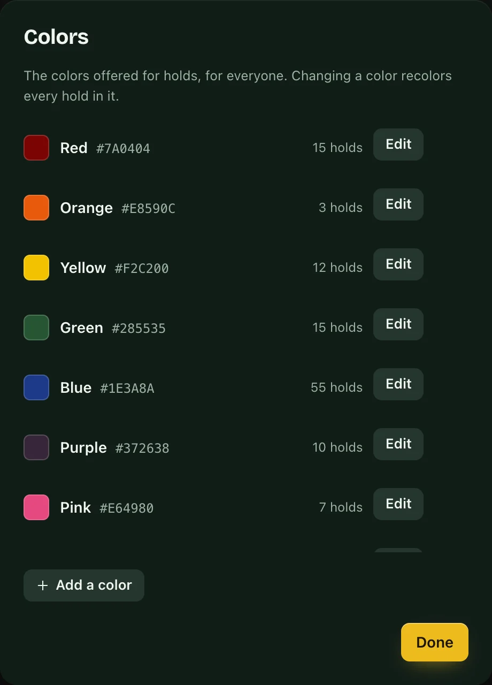

The color list is shared by everyone. **Edit colors** (in the hold editor and in Recolor holds) lists each color with how many holds use it.

- **Edit** changes a color's name or value. Type the value as **HEX** (`#1E3A8A`, `1e3a8a` or `#abc`) or **RGB** (three numbers, 0–255), or pick it from the swatch. Changing a color's value recolors every hold in it.
- **Add a color** adds a new one at the end. Names and values must be unique.
- **×** removes a color, offered only while no hold on the wall uses it.

#### Tap a hold


Tap a hold to see which climbs use it. From there you can edit its placement or color, add or replace its image, or **remove** it. The demo placeholder circles can get an image this way and keep all their routes.

#### Removing a hold

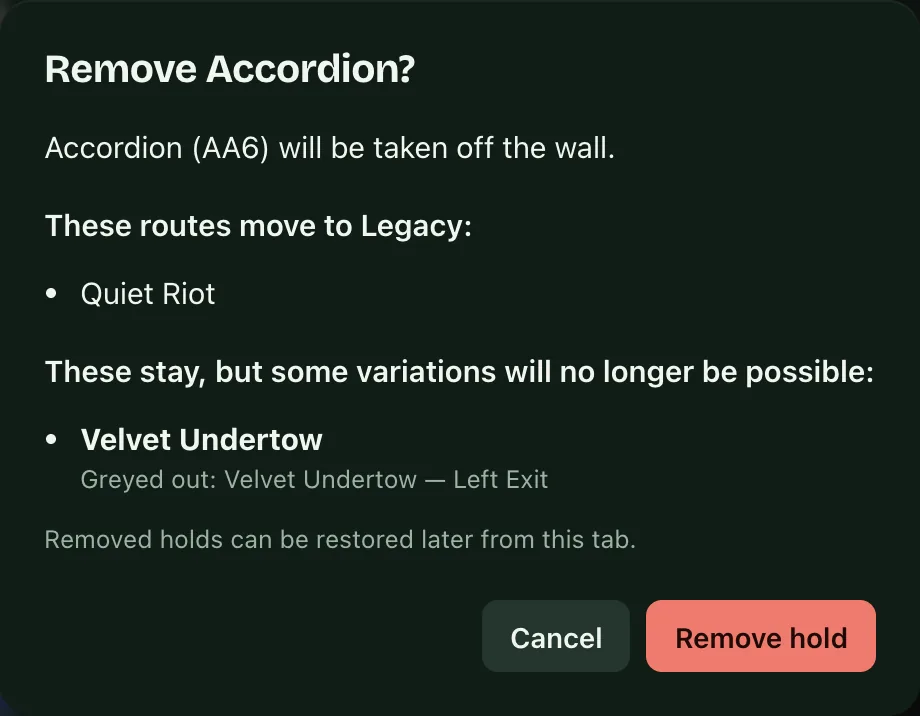

- A confirmation lists the routes that will move to Legacy and the families that will only lose some variations.
- A family where at least one variation can still be climbed stays in Climbs. It gets a "not all variations are possible" warning, and the impossible variations are greyed out, can't be logged, and show the removed hold as a red-ringed ghost.

  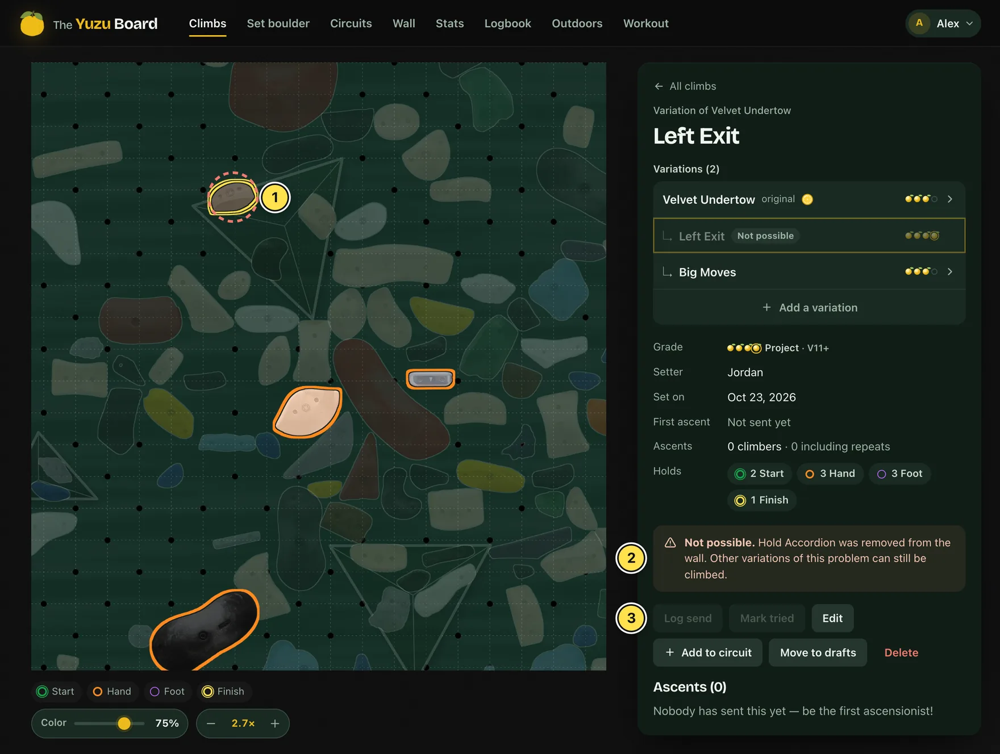

  ① The removed hold, as a red-ringed ghost. ② Why the climb is no longer possible. ③ **Log send** is turned off.

- Removed holds can be restored from the same tab, which brings their routes back.
- **Delete permanently** (next to Restore) deletes a removed hold and its photo for good. It only works once no climb uses the hold, Legacy ones included; otherwise it lists the climbs in the way, to delete or edit first.
- Retired routes are under **Climbs → Legacy**.

  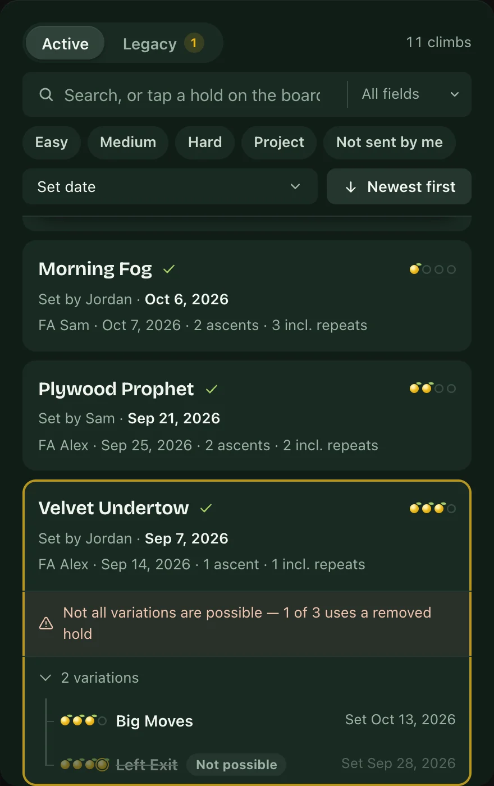 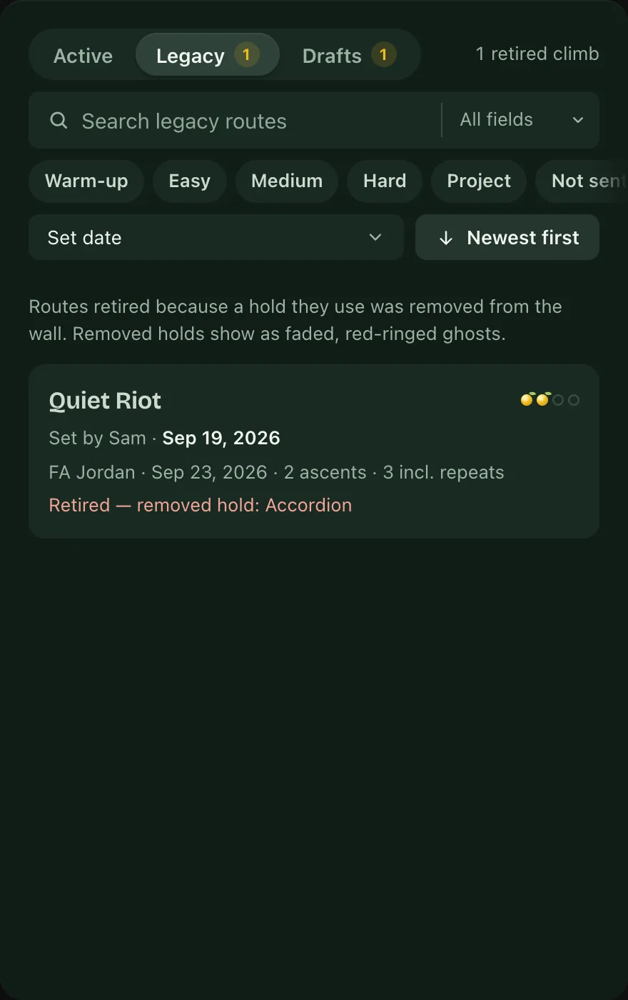

  Left: the family warning in Climbs. Right: Climbs → Legacy.

#### Volumes

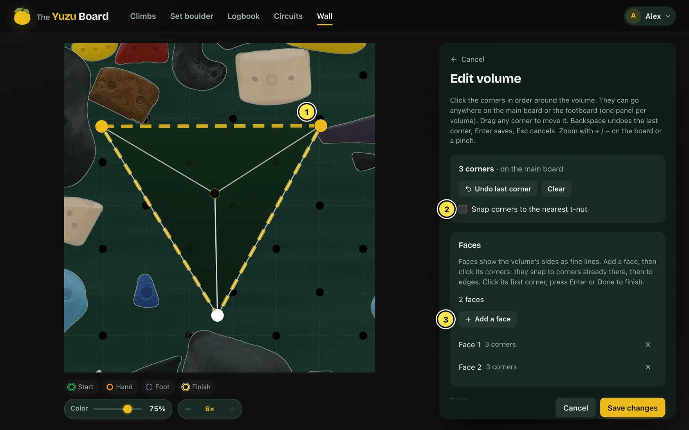

Wooden volumes are part of the wall's background.

- **＋ Add a volume**, then click the corners in order. They can go anywhere on one panel, not just on t‑nuts; ② snapping to t‑nuts is optional.
- ① **Drag any corner** to move it, including ones placed earlier; pressing anywhere else adds the next corner. Backspace undoes the last corner, Enter saves, Esc cancels.
- Choose **Black** or **Dark green** (a truer, darker green than the wall). Every volume has an off-white border, hidden wherever a hold sits on top, and a soft shadow.
- ③ **Faces:** a volume's sides can be drawn inside it as fine lines, so its 3D shape reads on the flat board. In the volume editor, **Add a face**, then click its corners. Clicks snap to a nearby corner first (the volume's or another face's), then to a nearby edge. Click its first corner again, press Enter or **Done** to finish. Backspace removes its last corner, Esc cancels it, and × in the list deletes a face. Moving a corner moves every face corner attached to it. Face lines are much thinner than the border and never thicken it where they run along it, and holds on top hide them.
- The grid stays faintly visible through a volume, at half strength.
- Volumes have no names, can't be selected as holds, and never appear in routes. The Wall tab lists them under **Volumes on the wall**, a dropdown closed by default. In the list, **Edit** reopens a volume to move its corners or change its color; **Delete** removes it.

### Legacy

The switch at the top of Climbs: routes where every variation uses a removed hold. Editing one and swapping out the removed hold brings it back to Active.

## Look & feel

"Midnight Grove": a neutral near-black page, a dark forest-green panel, and a spruce-green wall that stands apart from the page. Yuzu is the single accent color, and the hold-role colors are reserved for the board.

- **Type:** headings use **Bricolage Grotesque**, stored in `static/fonts/` under the SIL Open Font License, so it works offline. Body text uses the system font.
- **Grades:** shown as one to four little yuzu, from Easy ●○○○ to Project ●●●●.

  

- **The wall:** dark plywood with a faint wood grain. Placeholder holds look like small resin dots.
- **Holds:** every hold shows its color at the same opacity, 75% by default, with a thin white border (about ¾ of a screen pixel at any zoom). The **Color** slider under the board, beside the zoom, changes the opacity for all holds at once, so the photos show through; it's remembered in your browser.
- **Celebrations:** logging a send sets off a small burst of yuzu, and a first ascent gets a bigger one. This is skipped when the device asks for reduced motion.
- **Contrast:** all text meets WCAG AA contrast on every surface.

## Layout

```
app.py          Flask app + JSON API (FA / repeat / possible-vs-legacy logic lives here)
db.py           SQLite connection helpers + in-place migration of older databases
schema.sql      tables: climbers, holds, routes (parent_id = variation), route_holds, sends, volumes, circuits, colors
geometry.py     board dimensions, t-nut labels, nearest t-nut
hold_names.py   nouns for each letter, used to name holds
uploads/holds/  uploaded hold PNGs, and in board/ the smaller copies the wall draws, sized for each screen (git-ignored)
seed.py         demo holds, routes, and sends
docs/img/       README screenshots and diagrams
static/         index.html, css/app.css, fonts/, img/, js/ (board.js renders the SVG wall, palette.js the color list and its dialogs, icons.js the icon set, views/ hold the panels)
tests/          API + geometry tests (stdlib unittest)
```
